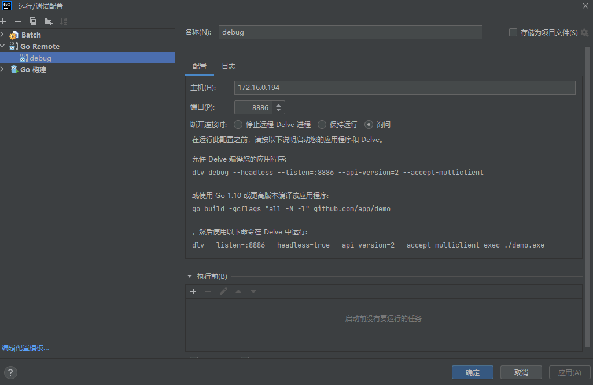
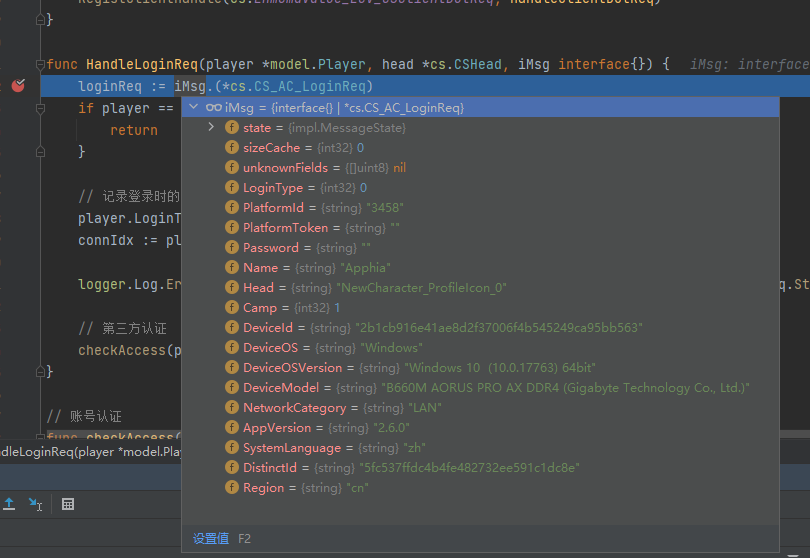

# windows下构建配置文件、构建proto、实现远程debug 

### 准备

```
1、安装goV1.20或以上版本，配置相关环境;

2、下载protoc，配置环境变量

3、下载git，配置好账号信息
 
```
<span style="color:red">注意，因为本项目gnet框架的构建约束，在windows环境无法构建启服，所以python可以不装</span>

### 构建配置文件

```
执行 win/build_excel.bat 脚本
```

### 构建proto文件

```
执行 win/build_proto.bat 脚本
``` 

### 远程debug

```
1、在远程linux机器（默认已经配置好Go环境）执行脚本 win/start_dlv.sh，启动dlv服务监听游戏服端口（其它服同理）

2、在本地IDE(比如GoLand)上新建调试配置，如图——输入linux机器 IP和配置的dlv端口（比如8886），启动即可实现远程debug
```

<span style="color:red">
注意：
<br/>1、脚本中PORT=8886端口可视情况修改，用于本地远程连接debug端口用；
<br/>2、两端代码尽量保持一致，不然会出现debug错行的情况
</span>





### 脚手架说明

- proto 源文件内联在 `protocol/` 目录下维护(不再从外部 proto 仓库拉取),
  `win/build_proto.bat` 已去除仓库同步逻辑, 直接构建;
- 运营平台 proto 仅保留 `scommon`(`protocol/opt/scommon/`),
  需要接入运营平台时修改 `win/build_opt_proto.bat` 中的仓库地址;
- 新增数据库表后需重新执行 `win/build_proto.bat` 生成 `tools/db` 相关代码;
- gnet 框架构建约束: Windows 无法编译启服, 启服相关验证请在 Linux 下进行。
